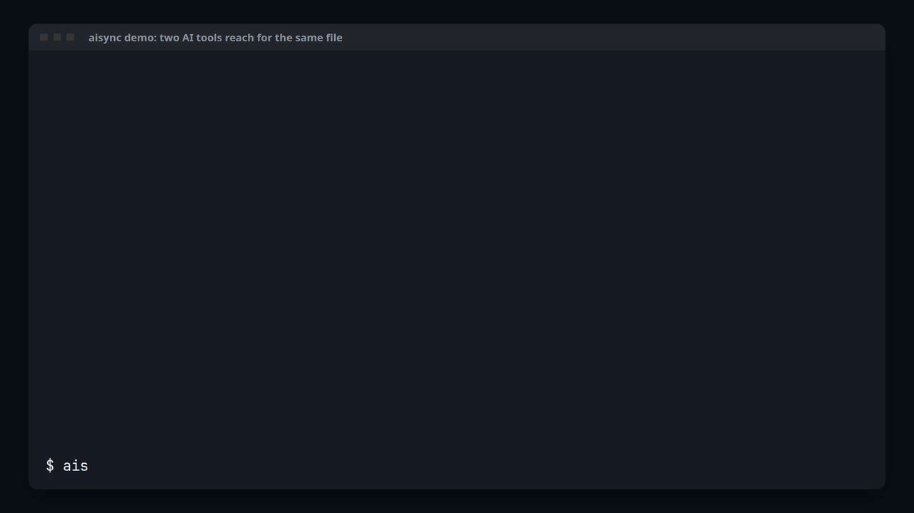

<!-- translated from README.md; the English README is the source of truth -->
[English](README.md) · [中文](README.zh-CN.md) · [日本語](README.ja.md) · [한국어](README.ko.md) · [Español](README.es.md) · [Français](README.fr.md) · **Deutsch** · [Português](README.pt.md) · [Русский](README.ru.md)


<div align="center">


# aisync: Multi-Agent-Kontextverwaltung, Koordination & Beobachtbarkeit

**Ein lokaler Hub für Entwickler, die mit mehreren KI-Coding-Agenten arbeiten: den richtigen Kontext teilen, parallele Arbeit koordinieren und nachprüfen, was tatsächlich passiert ist.**

aisync ist **im Kern agentenunabhängig**. Es bietet native Hooks für Claude Code, Codex und Cursor und stellt seinen Hub über eine CLI, einen MCP-Server oder gemeinsame Anweisungsdateien auch anderen Agenten zur Verfügung. Diese drei nativen Integrationen **begrenzen nicht**, welche Agenten aisync nutzen können.

[](https://github.com/MaxonT/aisync/actions/workflows/ci.yml)
[](https://github.com/MaxonT/aisync/releases)


[](https://pypi.org/project/aisync-cli/)
[](https://www.npmjs.com/package/@mingyang2026/aisync-cli)
[](https://github.com/MaxonT/homebrew-tap)
[](https://github.com/MaxonT/aisync/pkgs/container/aisync)
[](https://github.com/MaxonT/aisync/stargazers)

**Englisch** · [中文](README.zh-CN.md) · [Webseite](https://maxont.github.io/aisync/) · [Demo-Statusboard](https://maxont.github.io/aisync/board/)

</div>

> [!NOTE]
> **Mehrere Coding-Agenten sollten nicht mit isolierten Regeln, widersprüchlicher Dateizuständigkeit und getrennten Historien arbeiten müssen.**
> aisync ist ein **lokaler, überprüfbarer Hub** (`~/.ai-sync/`, ein Git-Repo), der für Multi-Agent-Workflows gedacht ist:
>
> - **Kontextverwaltung:** Regeln teilen und 3-Wege-synchronisieren; Kernkontext vorab laden und relevanten Kontext bei Bedarf einspielen, auch mitten in einer Sitzung, sofern Hooks verfügbar sind.
> - **Koordination mehrerer Agenten:** Dateiclaims deklarieren, überlappende Claims erkennen (Exit-Code 3), Zuständigkeit freigeben und Blocker sowie die Aktivität anderer Agenten sichtbar machen.
> - **Beobachtbarkeit & Verifikation:** Agentenaktivität, Blocker und Zustand über das Journal, Statusberichte und das Board prüfen; `aisync verify` prüft die Hash-Kette des Journals auf Manipulation.
>
> Dateiclaims sind **kooperativ**, keine vom Betriebssystem erzwungenen Sperren: Agenten müssen das Claim-Protokoll verwenden. Die Hash-Kettenprüfung erkennt Änderungen an aufgezeichneten Ereignissen; sie beweist nicht, dass jede beanspruchte Aktion tatsächlich stattgefunden hat.

## Für wen es gedacht ist

Entwickler, die **zwei oder mehr KI-Coding-Agenten** über ein oder mehrere Repositories hinweg einsetzen, besonders wenn Agenten parallel arbeiten, Aufgaben übergeben oder ein gemeinsames Protokoll von Entscheidungen und Blockern brauchen. aisync ist kein weiterer Coding-Agent und kein Task-Orchestrator: Es ist die **gemeinsame Kontext- und Koordinationsschicht**, die diese Agenten nutzen können.

## Seht es

<div align="center">

### The Agent Swarm Floor


https://github.com/user-attachments/assets/f741ef6f-0c10-46f4-8c94-769c6e02d30e


## Integrationen: native Hooks sind nicht die Kompatibilitätsgrenze

| Integration | Wer sie nutzen kann | Was zu erwarten ist |
|---|---|---|
| **Native hooks** | Claude Code, Codex, Cursor | Automatische Zustellung von Kontext und Meldungen an unterstützten Hook-Ereignissen, plus Zugriff auf die Koordinations- und Journalbefehle von aisync |
| **MCP server** | MCP-kompatible Agenten | Stellt Regeln, Regelergänzungen, Protokollierung, Claims, Freigaben, Meldungen, Status und Aufräumen bereit; ein Agent muss die Tools aufrufen |
| **CLI** | Agenten, die Shell-Befehle ausführen können | Direkter Zugriff auf Hub-Operationen wie `aisync claim`, `aisync news`, `aisync log` und `aisync verify` |
| **Shared instruction files** | Agenten, die unterstützte Anweisungsdateien lesen | Nur dauerhafte Regeln und Kontext; keine automatischen Meldungen mitten in der Sitzung und keine Durchsetzung von Dateiclaims |

**Kompatibilität ist nicht dasselbe wie automatische Integration.** Für Agenten ohne native Hooks hängen die Funktionen von der MCP- bzw. CLI-Nutzung und der Konfiguration des Agenten ab. aisync fängt nicht automatisch alle Bearbeitungen ab und garantiert nicht, dass jeder Agent Dateiclaims respektiert.

<p align="center"></p>

## Installation

**Übergeben Sie es Ihrer KI.** Sie liest die Seite, macht zuerst einen Probelauf und fragt, bevor sie etwas ändert:

```text
Read https://maxont.github.io/aisync/install and install aisync for me.
```

**Oder im Terminal.** Die Installation läuft mit uv, pipx oder pip und ändert nie Ihre Shell-Konfiguration:

```bash
curl -fsSL https://maxont.github.io/aisync/install.sh | bash
```

Benötigt Python 3.11+ und git, unter macOS oder Linux. Sonst nichts: aisync verwendet nur die Standardbibliothek.

**📦 Oder über einen Paketmanager.** Der Befehl heißt weiterhin `aisync`:

```bash
pipx install aisync-cli           # 🐍 PyPI (or: uv tool install aisync-cli)
npx @mingyang2026/aisync-cli --version   # npm 0.2.9
brew install maxont/tap/aisync    # 🍺 Homebrew tap (Python 3.14 first)
docker run --rm ghcr.io/maxont/aisync --version   # 🐳 GHCR image
```


### Zwei Agenten, eine Datei



<sub>Ein echter Terminallauf: `aisync demo` (synthetische Daten), danach greifen zwei Tools nach derselben Datei.
Schritt für Schritt: [So funktioniert es](https://maxont.github.io/aisync/how-it-works/) · derselbe Demo-Hub als
[Statusboard](https://maxont.github.io/aisync/board/).</sub>

</div>

| Bedarf bei mehreren Agenten | Was aisync bereitstellt |
|---|---|
| **Kontextverwaltung** | 3-Wege-synchronisierte Regeln, geschichtetes Regelladen und relevante Meldungen mitten in der Sitzung über Hooks |
| **Koordination mehrerer Agenten** | Kooperative Dateiclaims und Freigaben, Überschneidungserkennung (Exit 3), Blocker und Aktivitätsmeldungen |
| **Beobachtbarkeit & Verifikation** | Hash-verkettetes Ereignisjournal, `aisync verify`, `status`, `report`, `tail` und ein statisches `board` |

aisync übernimmt auch den Regelteil: ein Regelblock, der in die Regeldatei jedes Tools kopiert wird, 3-Wege-synchronisiert; Konflikte werden nie überschrieben.

**Dogfooding:** 6,700+ Journal-Ereignisse im eigenen Hub des Autors.

## Warum nicht einfach AGENTS.md?

Behalten Sie AGENTS.md für die dauerhaften Anweisungen eines Repos. aisync ergänzt sie und deckt ab, was eine einzelne Datei nicht leisten kann: den Kontext, der sich während der Arbeit der Agenten ändert.

| | AGENTS.md | aisync |
|---|---|---|
| Umfang | Dauerhafte Anweisungen für Agenten, die in einem Repo arbeiten | Ein gemeinsamer Hub über konfigurierte Agenten und Repositories |
| Wann gelesen | Beim Start einer Sitzung | Beim Start und mitten in der Sitzung über Hooks |
| Wer bearbeitet was | Nicht abgedeckt | Kooperative Claims: eine Überschneidung liefert dem Aufrufer Exit 3 |
| Manipulationsnachweis | Vom Dateiformat nicht bereitgestellt | Hash-verkettetes Journal: `aisync verify` erkennt Änderungen an aufgezeichneten Ereignissen |
| Kontext pro Sitzung | Ganze Datei, jedes Mal | Nur ausgelöste Regeln: immer geladene Regeln 20,673 → 7,876 Tokens* |

<sub>\* Einmalig gemessen auf dem eigenen Hub eines Autors (2026-11-08), immer geladene Regeln vor und nach dem geschichteten Laden. Eine Maschine, kein Benchmark: Ihre Zahlen werden abweichen. `aisync tidy` meldet Ihr eigenes Regelbudget und die nicht zitierten Regeln.</sub>

## Verwendung

```bash
aisync demo            # a throwaway hub with a synthetic two-week journal
aisync init            # create ~/.ai-sync (or wherever AISYNC_HOME points)
aisync install-hooks   # shows every tool config change as a diff, then asks
aisync watch &         # event-driven sync loop (or run `aisync sync` by hand)
```

Was ein Agent während einer Sitzung tut:

```bash
aisync claim   -a codex -p api -f app/payments/ -m "SDK upgrade"  # 3 = taken
aisync log     -a codex -p api -m "SDK 5.0, retries kept"
aisync rule add -a codex --when "changing an API" --do "add a contract test"
aisync release -a codex -p api
```

| Befehl | Was er tut |
|---|---|
| `init` | legt den Hub an: gemeinsame Regeln, Journal, Konfiguration, lokales Git-Repo |
| `log` | hängt ein Ereignis an (`dev_log`, `decision`, `blocked`, `unblocked`, `rule_change`, `note`) |
| `rule add` / `rule list` | jeder Agent fügt eine gemeinsame Regel hinzu (`--when/--do/--not`, `--topic`, `--replaces R-012`); die Kopie jedes Tools erhält sie bei der nächsten Synchronisation |
| `rule lint` / `rule rewrite` / `rule enforcement` | Regeln, die nicht der When/Do/Not-Form entsprechen / umschreiben per ID, ohne eine Tatsache zu verlieren / welcher Test oder Hook jede Regel durchsetzt |
| `rule enforce` | festlegen, was eine bestehende Regel absichert: `rule enforce R-012 --enforced-by tests/test_x.py`, `--judgment-only "<why>"` oder `--planned "<the check to write>" --size S\|M\|L` für eine Prüfung, die möglich, aber noch nicht geschrieben ist. `rule enforcement` listet danach jede offene Regel mit dem nächsten Schritt: eine Durchsetzungsdatei, die fehlt, ein Plan, dessen Frist überschritten ist (S 7, M 30, L 90 Tage), eine Regel ohne Plan. Die Uhr eines Plans läuft nur vorwärts: ein späteres Datum, eine größere Größe oder ein Wechsel zu judgment-only braucht `--reason` und bleibt protokolliert |
| `tidy` | Regel-Sachbearbeiter: wahrscheinliche Dubletten, lange nicht zitierte Regeln, Kernschicht über Budget; nur Vorschläge, Sie haken ab |
| `rulecheck` | belegt, dass eine Regelbereinigung keine harte Tatsache verloren hat (Pfade, Zahlen, Befehle, IDs) |
| `instinct` | optionale Gewohnheitsliste, aus früheren Fehlern gewachsen, wird in jede Sitzung eingespielt |
| `gate` | Test-Gate beim Push: `gate check` führt `./check.sh --fast` auf einem Commit aus; der Git-Pre-Push-Hook ruft `gate pre-push` auf (Opt-in, siehe unten) |
| `web-inbox` | importiert jetzt Web-Claude-Ereignisse aus dem Branch `web-inbox` (`--no-fetch` nutzt die zuletzt geholte Kopie) |
| `guard` | Claude-Code-Hook: eine Sitzung pro Repo; verweigert eine Bearbeitung, wenn eine andere Sitzung das Repo hält (Opt-in, siehe unten) |
| `lease` | wer welches Repo hält (`lease status`), oder es von Hand freigeben (`lease release --key`) |
| `wt` | das eigene Git-Worktree einer Sitzung: `wt start` öffnet es; `wt land` übernimmt es in main und braucht `--yes` (ohne: Probelauf) |
| `mcp` | stellt den Hub über stdio für jeden MCP-Agenten bereit (`pip install 'aisync-cli[mcp]'`) |
| `claim` / `release` / `claims` | wer gerade an welchen Dateien arbeitet; Überschneidung = Exit 3 |
| `news` | was andere Tools getan haben, seit diese Sitzung zuletzt nachgesehen hat |
| `hook <tool>` | Einstiegspunkt für die Hooks von Claude Code, Codex und Cursor (liest Hook-JSON, schlägt nie fehl) |
| `install-hooks` | verdrahtet die Hooks, legt den Regelblock an, fügt den Git-Hook für den `Agent:`-Trailer hinzu; zeigt zuerst den Diff und fragt vor dem Schreiben (`--dry-run`, `--yes`) |
| `status` | Zustand, Konflikte, Claims, Blocker, Metriken (Exit 1, wenn etwas Ihre Aufmerksamkeit braucht) |
| `board` | schreibt den Hub als eine statische HTML-Seite: Claims, Blocker, wer was getan hat, Zeitachse |
| `report` | schreibgeschützte Selbstprüfung: stille Tools, Commits ohne `Agent:`-Trailer, veraltete Blocker |
| `tail` | neueste Journal-Ereignisse |
| `verify` | prüft die Hash-Kette |
| `sync` / `watch` | führt einen Synchronisationszyklus aus / die entprellte, ereignisgesteuerte Schleife |
| `resolve` / `resume` | entscheidet einen Regelkonflikt / setzt Fehlerzähler nach einer Pause zurück |
| `demo` | der oben gezeigte Wegwerf-Hub |
| `version` / `-v` / `-V` / `--version` | gibt die Version aus |
| `help [command]` | diese Übersicht oder die Optionen eines Befehls (`aisync help log`) |
| `update` | prüft GitHub auf ein neueres Release und gibt den Befehl zum Aktualisieren aus (uv, pipx, install.sh, brew oder pip); installiert nie selbst |
| `doctor` | prüft python, git, den Hub-Ordner und die Journal-Kette (Exit 1 bei jedem Fehler) |
| `completion` | gibt ein Shell-Vervollständigungsskript für bash, zsh oder fish aus: `eval "$(aisync completion zsh)"` |

## Neu in 0.2.0: Regeln als Schnittstellen, in Schichten geladen

Eine Regeldatei wächst, bis jede Sitzung dafür bezahlt und niemand sie mehr liest. 0.2.0 behandelt eine Regel wie eine API:

- **When / Do / Not.** Jede Regel ist eine Zeile mit stabiler ID: `[R-087] When: <trigger>. Do: <action>. Not: <forbidden>.`
  Das Warum geht ins Journal, nicht in die Regel. `rule_spec = true` lehnt alles andere ab; `rule lint` listet Fehlpassungen auf; `rule rewrite` formt alte Regeln per ID um und verweigert jedes Umschreiben, das einen Pfad, eine Zahl oder einen Befehl verliert.
- **Schichten.** Markieren Sie eine Tool-Kopie mit `layer = "core"`: Sie führt `core_topics` vollständig und jedes andere Thema als eine Zeile. Wenn ein Prompt oder ein Tool-Aufruf die Schlüsselwörter eines Themas (`[shelf]`) berührt, injiziert der Hook dieses Thema einmal pro Sitzung. Auf dem eigenen Hub des Autors sanken die immer geladenen Regeln dadurch von 20,673 auf 7,876 Tokens.
- **Ein stabiles Präfix.** `progress_file` lagert die Live-Fortschrittstabelle aus der gemeinsamen Seite aus, sodass die Seite byte-identisch bleibt und Prompt-Caches weiter greifen.
- **Ein Sachbearbeiter, kein Hausmeister.** `aisync tidy` schlägt vor (Dubletten, nicht zitierte Regeln, Budgetüberschreitungen) und ändert nie selbst; eine ersetzte Regel wandert mit ihrer ID nach `rules-archive.md`, nichts wird gelöscht.
- **Jeder Agent.** Drei Zugänge: die AGENTS.md-Seite, die CLI und `aisync mcp` (Tools: rules, rule_add, log, claim, release, news, status, tidy). Der Kern nutzt nur die Standardbibliothek; das MCP-SDK ist das optionale Extra `aisync-cli[mcp]`.

## Funktionsweise

<p align="center"></p>
<p align="center"><sub><a href="https://maxont.github.io/aisync/how-it-works/">Schritt für Schritt in eigenem Tempo durchgehen</a> (abspielen, pausieren, ← →)</sub></p>

Ein Synchronisationszyklus besteht aus `harvest` (neue Git-Commits in überwachten Repos werden zu Journal-Ereignissen, zugeordnet über ihren `Agent:`-Trailer) → `rules` (neue Einträge in Repos, die Sie in `rule_sources` auflisten) → `distribute` (3-Wege-Synchronisation des Regelblocks in jede Tool-Datei) → `render` (Fortschrittsseite) → `flush` (Commit des Hubs, optional Push). Jeder Schritt ist isoliert: ein Fehler blockiert nie die anderen.

Der Regelblock wird 3-Wege-synchronisiert. Hat sich nur die Wahrheit geändert, werden die Kopien überschrieben (mit Backup). Wurde eine Kopie bearbeitet und hat sonst niemand etwas geändert, wird die Änderung überall übernommen. Haben beide Seiten sich geändert, wird nichts überschrieben: Es entsteht ein Konflikt, den Sie lösen.

Zuverlässigkeit und Beobachtbarkeit: Timeouts und Wiederholungen mit Backoff bei jedem Git-Aufruf, Fehlerisolierung pro Schritt und pro Projekt, automatische Pause nach `fail_threshold` aufeinanderfolgenden Fehlern mit einer `ALERT.md` und einer Desktop-Benachrichtigung, ein Lauf-Protokoll pro Zyklus (`state/runs.jsonl`), Hook-Aufrufstatistiken und `aisync status` für all das.

## Konfiguration

`~/.ai-sync/config.toml` (setzen Sie `AISYNC_HOME`, um den Hub anderswo abzulegen):

```toml
roster = ["claude-code", "codex", "cursor"]   # tools `report` expects to hear from
scan_dirs = ["~/projects"]                    # every git repo inside is watched
rule_sources = []                             # repos whose AGENTS.md "## Meta rule" feeds shared rules
remote = ""                                   # e.g. "origin" to also push the hub

progress_file = "progress.md"                 # keep agents.md byte-stable; hooks inject progress at session start
rule_spec = true                              # rule add only accepts When/Do/Not rules
require_enforcer = false                      # true: every new rule names --enforced-by or --judgment-only
core_topics = ["Safety", "Meta"]              # topic headings a layered copy carries in full
instincts_path = ""                           # optional habit file injected at session start
tidy_daily = false                            # the watcher starts one `aisync tidy --write` a day
tidy_usage_globs = []                         # files whose R-### mentions count as a rule being used
gate_hook = false                            # opt-in: the git pre-push hook runs the test gate (gate.py)
guard_hook = false                           # opt-in: Claude Code runs the one-session-per-repo guard (guard.py)
web_inbox_secs = 0                           # 0 = off; else poll the web-inbox branch this often

[shelf]                                       # folded topic -> keywords that pull it into a session
Deploys = ["deploy", "terraform", "rollback"]

[[target]]                                    # files carrying the shared-rules block
label = "claude-code"
path = "~/.claude/CLAUDE.md"
layer = "core"                                # optional: fold non-core topics, inject them on demand
```

Damit `aisync watch` läuft, starten Sie es aus Ihren Anmeldeobjekten, einer systemd-User-Unit oder einem launchd-Agenten, der `aisync watch` ausführt; legen Sie `~/.ai-sync/STOP` an, um es sauber zu beenden.

**Opt-in-Funktionen (alle standardmäßig aus).** `gate_hook`, `guard_hook` und `web_inbox_secs` ändern das Verhalten außerhalb des Hubs, daher wird nichts aktiviert, bis Sie es setzen. Der Guard kann Bearbeitungen verweigern: Ist eine Sitzung ausgesperrt, führen Sie `aisync lease status` aus und, sobald die haltende Sitzung beendet ist, `aisync lease release --key <repo>`. Um den Guard zu entfernen, löschen Sie die Einträge `PreToolUse` und `SessionEnd` aus `~/.claude/settings.json`, deren Befehl auf ` guard` endet.

## Auf den Schultern von

> aisync: Multi-Agent-Kontextverwaltung, Koordination & Beobachtbarkeit. AGENTS.md war die Ausgangsidee.

| Projekt | Wie es aisync geprägt hat |
|---|---|
| [](https://github.com/agentsmd/agents.md) | Die Ausgangsidee: eine einfache Textdatei mit Anweisungen, die jeder Agent liest, ohne SDK. aisync behält diese Form für gemeinsame Regeln bei (ein Regelblock, kopiert in die AGENTS.md bzw. CLAUDE.md jedes Tools) und ergänzt, was eine statische Datei nicht sagen kann: wer gerade was bearbeitet und was sich seit Sitzungsbeginn geändert hat. |
| [](https://github.com/anthropics/claude-code) | Meldungen mitten in der Sitzung laufen über Claude-Code-Hooks: `aisync install-hooks` fügt SessionStart-, UserPromptSubmit- und PostToolUse-Einträge zu ~/.claude/settings.json hinzu, und `aisync hook claude-code` antwortet mit hookSpecificOutput.additionalContext nur, wenn ein anderes Tool etwas geändert hat. |
| [](https://github.com/openai/codex) | Codex liest ~/.codex/AGENTS.md; dort legt aisync den gemeinsamen Regelblock ab. Seine hooks.json kennt dieselben Ereignisse SessionStart / UserPromptSubmit / PostToolUse, daher nutzt `aisync hook codex` das Antwortformat von Claude Code wieder. |
| [Cursor](https://cursor.com/docs/agent/hooks) | Cursor-Hooks (~/.cursor/hooks.json) liefern Regeln und Fortschritt beim sessionStart und die Meldungen nach jedem postToolUse über additional_context, weil die User Rules von Cursor in der App selbst liegen und nicht in einer Datei, die aisync synchronisieren könnte. |
| [](https://github.com/git/git) | Das Journal übernimmt die Hash-Kette von git: Jedes Ereignis speichert die ID des vorherigen, und seine eigene ID ist ein SHA-256 aus dieser Verknüpfung plus Inhalt, sodass `aisync verify` jede geänderte, verlorene oder umgeordnete Zeile erkennt. Der Hub selbst ist ein lokales Git-Repo. |

aisync ist ein unabhängiges Projekt und nicht mit den oben genannten Projekten verbunden.

## Entwicklung

```bash
python3 -m unittest discover -s tests   # includes wheel -> venv -> demo
```

Die Bilder sind generiert: Das Terminal-GIF ist ein aufgezeichneter echter Lauf von
[`.github/refine/demo-terminal.json`](.github/refine/demo-terminal.json), die Animation zu „So funktioniert es“
stammt aus [`.github/refine/how-it-works.stages.json`](.github/refine/how-it-works.stages.json), und die
Danksagungen oben aus [`.github/refine/lineage.json`](.github/refine/lineage.json). Alle Demo-Daten sind synthetisch.

MIT-lizenziert.


## Weitere Videos, falls Sie mögen!

https://github.com/user-attachments/assets/5ea7928b-4985-4700-8551-90477a84df40

https://github.com/user-attachments/assets/91385ac4-714c-4a16-908b-1859ef1c78e2


https://github.com/user-attachments/assets/bf661d5c-b7b1-4876-8469-2e11dd95b232


https://github.com/user-attachments/assets/d32f3abd-2986-4fbf-83a2-be287f0185a7

