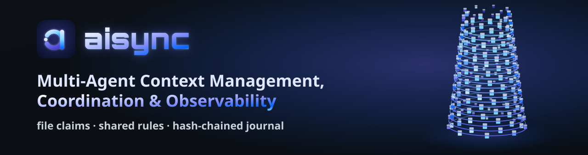
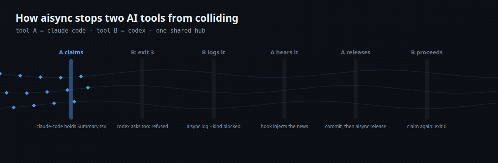

<!-- translated from README.md; the English README is the source of truth -->
[English](README.md) · [中文](README.zh-CN.md) · [日本語](README.ja.md) · [한국어](README.ko.md) · [Español](README.es.md) · **Français** · [Deutsch](README.de.md) · [Português](README.pt.md) · [Русский](README.ru.md)


<div align="center">



# aisync : gestion du contexte, coordination et observabilité multi-agents

**Un hub local unique pour les développeurs qui travaillent avec plusieurs agents de codage IA : partagez le bon contexte, coordonnez les travaux concurrents et vérifiez ce qui s'est réellement passé.**

aisync est **agnostique vis-à-vis des agents** dans son cœur. Il fournit des hooks natifs pour Claude Code, Codex et Cursor, et expose son hub à d'autres agents via une CLI, un serveur MCP ou des fichiers d'instructions partagés. Ces trois intégrations natives **ne** limitent **pas** les agents pouvant utiliser aisync.

[](https://github.com/MaxonT/aisync/actions/workflows/ci.yml)
[](https://github.com/MaxonT/aisync/releases)


[](https://pypi.org/project/aisync-cli/)
[](https://www.npmjs.com/package/@mingyang2026/aisync-cli)
[](https://github.com/MaxonT/homebrew-tap)
[](https://github.com/MaxonT/aisync/pkgs/container/aisync)
[](https://github.com/MaxonT/aisync/stargazers)

[English](README.md) · **Français** · [中文](README.zh-CN.md) · [Site web](https://maxont.github.io/aisync/) · [Tableau d'état de la démo](https://maxont.github.io/aisync/board/)

</div>

> [!NOTE]
> **Plusieurs agents de codage ne devraient pas avoir à travailler avec des règles isolées, une propriété de fichiers en conflit et des historiques déconnectés.**
> aisync est un **hub local et vérifiable** (`~/.ai-sync/`, un dépôt git) conçu pour les workflows multi-agents :
>
> - **Gestion du contexte :** partage et synchronisation 3 voies des règles ; charge le contexte central dès le départ et injecte le contexte pertinent à la demande, y compris les mises à jour en cours de session lorsque les hooks sont disponibles.
> - **Coordination multi-agents :** déclare des revendications de fichiers, détecte les revendications qui se chevauchent (code de sortie 3), libère la propriété, et fait remonter les blocages et l'activité des autres agents.
> - **Observabilité et vérification :** inspecte l'activité des agents, les blocages et l'état de santé via le journal, les rapports d'état et le tableau ; `aisync verify` vérifie la chaîne de hachage du journal pour détecter toute altération.
>
> Les revendications de fichiers sont **coopératives**, pas des verrous imposés par le système d'exploitation : les agents doivent utiliser le protocole de revendication. La vérification de la chaîne de hachage détecte les modifications des événements enregistrés ; elle ne prouve pas que chaque action revendiquée a bien eu lieu.

## Pour qui

Développeurs qui utilisent **deux agents de codage IA ou plus** sur un ou plusieurs dépôts, en particulier lorsque les agents travaillent en parallèle, se passent des tâches, ou ont besoin d'un registre partagé des décisions et des blocages. aisync n'est pas un autre agent de codage ni un orchestrateur de tâches : c'est la **couche partagée de contexte et de coordination** que ces agents peuvent utiliser.

## En images

<div align="center">

### Le sol de l'essaim d'agents


https://github.com/user-attachments/assets/f741ef6f-0c10-46f4-8c94-769c6e02d30e


## Intégrations : les hooks natifs ne sont pas la frontière de compatibilité

| Intégration | Qui peut l'utiliser | À quoi s'attendre |
|---|---|---|
| **Hooks natifs** | Claude Code, Codex, Cursor | Livraison automatique du contexte et des nouvelles aux événements de hook pris en charge, plus accès aux commandes de coordination et de journal d'aisync |
| **Serveur MCP** | Agents compatibles MCP | Expose les règles, l'ajout de règles, la journalisation, les revendications, les libérations, les nouvelles, le statut et le tri ; l'agent doit invoquer les outils |
| **CLI** | Agents capables d'exécuter des commandes shell | Accès direct aux opérations du hub comme `aisync claim`, `aisync news`, `aisync log` et `aisync verify` |
| **Fichiers d'instructions partagés** | Agents qui lisent les fichiers d'instructions pris en charge | Règles et contexte permanents uniquement ; pas de nouvelles automatiques en cours de session ni d'application des revendications de fichiers |

**La compatibilité n'est pas équivalente à une intégration automatique.** Pour les agents sans hooks natifs, les fonctionnalités dépendent de l'usage et de la configuration MCP/CLI de l'agent. aisync n'intercepte pas automatiquement toutes les modifications et ne garantit pas que chaque agent respectera les revendications de fichiers.

<p align="center"></p>

## Installation

**Donnez-le à votre IA.** Elle lit la page, fait d'abord un essai à blanc et demande confirmation avant de modifier quoi que ce soit :

```text
Read https://maxont.github.io/aisync/install and install aisync for me.
```

**Ou dans un terminal.** L'installation se fait avec uv, pipx ou pip, et ne modifie jamais votre configuration de shell :

```bash
curl -fsSL https://maxont.github.io/aisync/install.sh | bash
```

Nécessite Python 3.11+ et git, sur macOS ou Linux. Rien d'autre : aisync n'utilise que la bibliothèque standard.

**📦 Ou depuis un gestionnaire de paquets.** La commande reste `aisync` :

```bash
pipx install aisync-cli           # 🐍 PyPI (or: uv tool install aisync-cli)
npx @mingyang2026/aisync-cli --version   # 📦 npm (0.2.7 now; 0.2.8 pending)
brew install maxont/tap/aisync    # 🍺 Homebrew tap (Python 3.14 first)
docker run --rm ghcr.io/maxont/aisync --version   # 🐳 GHCR image
```


### Deux agents, un seul fichier


<sub>Exécution réelle dans un terminal : `aisync demo` (données synthétiques), puis deux outils tentent d'accéder au même fichier.
Pas à pas : [comment ça marche](https://maxont.github.io/aisync/how-it-works/) · le même hub de démo en
[tableau d'état](https://maxont.github.io/aisync/board/).</sub>

</div>

| Besoin multi-agents | Ce qu'aisync apporte |
|---|---|
| **Gestion du contexte** | Règles synchronisées en 3 voies, chargement de règles par couches et nouvelles pertinentes en cours de session via les hooks |
| **Coordination multi-agents** | Revendications et libérations de fichiers coopératives, détection des chevauchements (sortie 3), blocages et mises à jour d'activité |
| **Observabilité et vérification** | Journal d'événements à chaîne de hachage, `aisync verify`, `status`, `report`, `tail` et un `board` statique |

aisync gère aussi la partie règles : un bloc de règles unique, copié dans le fichier de règles de chaque outil, synchronisé en 3 voies, les conflits n'étant jamais écrasés.

**Utilisé en interne :** plus de 6 700 événements de journal sur le hub de l'auteur.

## Pourquoi pas seulement AGENTS.md ?

Gardez AGENTS.md pour les instructions permanentes d'un dépôt. aisync se place à côté et couvre ce qu'un fichier unique ne peut pas faire : le contexte qui change pendant que les agents travaillent.

| | AGENTS.md | aisync |
|---|---|---|
| Portée | Instructions permanentes pour les agents travaillant dans un dépôt | Un hub partagé entre les agents configurés et les dépôts |
| Moment de lecture | Au démarrage de la session | Au démarrage, et en cours de session via les hooks |
| Qui modifie quoi | Non couvert | Revendications coopératives : un chevauchement renvoie la sortie 3 à l'appelant |
| Preuve d'altération | Non fournie par le format de fichier | Journal à chaîne de hachage : `aisync verify` détecte les altérations des événements enregistrés |
| Contexte par session | Le fichier entier, à chaque fois | Seulement les règles déclenchées : règles toujours chargées de 20 673 à 7 876 tokens* |

<sub>\* Mesuré une seule fois sur le hub personnel d'un auteur (2026-11-08), règles toujours chargées avant et après le chargement par couches. Une seule machine, ce n'est pas un benchmark : vos chiffres seront différents. `aisync tidy` indique votre propre budget de règles et les règles non citées.</sub>

## Utilisation

```bash
aisync demo            # a throwaway hub with a synthetic two-week journal
aisync init            # create ~/.ai-sync (or wherever AISYNC_HOME points)
aisync install-hooks   # shows every tool config change as a diff, then asks
aisync watch &         # event-driven sync loop (or run `aisync sync` by hand)
```

Ce qu'un agent fait pendant une session :

```bash
aisync claim   -a codex -p api -f app/payments/ -m "SDK upgrade"  # 3 = taken
aisync log     -a codex -p api -m "SDK 5.0, retries kept"
aisync rule add -a codex --when "changing an API" --do "add a contract test"
aisync release -a codex -p api
```

| Commande | Ce qu'elle fait |
|---|---|
| `init` | crée le hub : règles partagées, journal, configuration, dépôt git local |
| `log` | ajoute un événement (`dev_log`, `decision`, `blocked`, `unblocked`, `rule_change`, `note`) |
| `rule add` / `rule list` | un agent quelconque ajoute une règle partagée (`--when/--do/--not`, `--topic`, `--replaces R-012`) ; la copie de chaque outil la reçoit à la synchronisation suivante |
| `rule lint` / `rule rewrite` / `rule enforcement` | règles hors du format When/Do/Not / réécriture par ID sans perte d'information / quel test ou hook fait respecter chaque règle |
| `rule enforce` | indique ce qui fait respecter une règle existante : `rule enforce R-012 --enforced-by tests/test_x.py`, `--judgment-only "<why>"`, ou `--planned "<the check to write>" --size S\|M\|L` pour un contrôle possible mais pas encore écrit. `rule enforcement` liste ensuite chaque point ouvert avec sa prochaine étape : un fichier d'application disparu, un plan dont le délai est dépassé (S 7, M 30, L 90 jours), une règle sans plan. L'horloge d'un plan ne fait qu'avancer : une date ultérieure, une taille plus grande ou un passage à un jugement seul exigent `--reason` et restent consignés |
| `tidy` | greffier des règles : doublons probables, règles que personne n'a citées récemment, couche centrale au-delà du budget ; propositions seulement, c'est vous qui cochez |
| `rulecheck` | prouve qu'un nettoyage des règles n'a perdu aucun fait important (chemins, nombres, commandes, IDs) |
| `instinct` | liste d'habitudes facultative, construite à partir des erreurs passées et injectée dans chaque session |
| `gate` | porte de test au moment du push : `gate check` exécute `./check.sh --fast` sur un commit ; le hook git pre-push appelle `gate pre-push` (optionnel, voir plus bas) |
| `web-inbox` | importe maintenant les événements de Claude web depuis la branche `web-inbox` (`--no-fetch` utilise la dernière copie récupérée) |
| `guard` | hook Claude Code : une session par dépôt ; refuse une modification quand une autre session détient le dépôt (optionnel, voir plus bas) |
| `lease` | qui détient quel dépôt (`lease status`), ou libération manuelle (`lease release --key`) |
| `wt` | le worktree git propre à une session : `wt start` l'ouvre ; `wt land` l'intègre à main et exige `--yes` (sans lui : un essai à blanc) |
| `mcp` | sert le hub à tout agent MCP via stdio (`pip install 'aisync-cli[mcp]'`) |
| `claim` / `release` / `claims` | qui travaille sur quels fichiers en ce moment ; chevauchement = sortie 3 |
| `news` | ce que les autres outils ont fait depuis la dernière consultation de cette session |
| `hook <tool>` | point d'entrée pour les hooks de Claude Code, Codex et Cursor (lit le JSON du hook, n'échoue jamais) |
| `install-hooks` | branche les hooks, initialise le bloc de règles, ajoute le hook de trailer git `Agent:` ; affiche le diff d'abord et demande avant d'écrire (`--dry-run`, `--yes`) |
| `status` | santé, conflits, revendications, blocages, métriques (sortie 1 quand quelque chose requiert votre attention) |
| `board` | écrit le hub comme une page HTML statique : revendications, blocages, qui a fait quoi, chronologie |
| `report` | auto-contrôle en lecture seule : outils silencieux, commits sans trailer `Agent:`, blocages périmés |
| `tail` | derniers événements du journal |
| `verify` | vérifie la chaîne de hachage |
| `sync` / `watch` | exécute un cycle de synchronisation / la boucle événementielle avec anti-rebond |
| `resolve` / `resume` | tranche un conflit de règles / remet à zéro les compteurs d'échecs après une pause |
| `demo` | le hub jetable présenté plus haut |
| `version` / `-v` / `-V` / `--version` | affiche la version |
| `help [command]` | cet écran, ou les options d'une commande (`aisync help log`) |
| `update` | vérifie sur GitHub s'il existe une version plus récente et affiche la commande de mise à jour (uv, pipx, install.sh, brew ou pip) ; il n'installe jamais rien seul |
| `doctor` | vérifie python, git, le dossier du hub et la chaîne du journal (sortie 1 en cas d'échec) |
| `completion` | affiche un script de complétion pour bash, zsh ou fish : `eval "$(aisync completion zsh)"` |

## Nouveautés de la 0.2.0 : des règles comme interfaces, chargées par couches

Un fichier de règles grossit jusqu'au moment où chaque session le paie et où plus personne ne le lit. La 0.2.0 traite une règle comme une API :

- **When / Do / Not.** Chaque règle tient sur une ligne avec un ID stable : `[R-087] When: <trigger>. Do: <action>. Not: <forbidden>.`
  La raison va dans le journal, pas dans la règle. `rule_spec = true` refuse tout le reste ; `rule lint` liste les règles non conformes ;
  `rule rewrite` remodèle les anciennes règles par ID et refuse une réécriture qui perd un chemin, un nombre ou une commande.
- **Couches.** Marquez une copie d'outil avec `layer = "core"` : elle contient en entier les `core_topics` et chaque autre thème sur une seule ligne.
  Quand un prompt ou un appel d'outil touche les mots-clés d'un thème (`[shelf]`), le hook injecte ce thème une fois par session.
  Sur le hub de l'auteur, cela a fait passer les règles toujours chargées de 20 673 à 7 876 tokens.
- **Un préfixe stable.** `progress_file` sort le tableau de progression vivant de la page partagée, si bien que la page reste identique octet par octet et que les caches de prompts continuent de fonctionner.
- **Un greffier, pas un homme à tout faire.** `aisync tidy` propose (doublons, règles non citées, dépassements de budget) et ne modifie jamais rien ;
  une règle remplacée passe dans `rules-archive.md` avec son ID : rien n'est supprimé.
- **N'importe quel agent.** Trois portes : la page AGENTS.md, la CLI et `aisync mcp` (outils : rules, rule_add, log, claim,
  release, news, status, tidy). Le cœur reste en bibliothèque standard ; le SDK MCP est l'extra optionnel `aisync-cli[mcp]`.

## Fonctionnement

<p align="center"></p>
<p align="center"><sub><a href="https://maxont.github.io/aisync/how-it-works/">Parcourez-le à votre rythme</a> (lecture, pause, ← →)</sub></p>

Un cycle de synchronisation est `harvest` (les nouveaux commits git des dépôts surveillés deviennent des événements du journal, attribués grâce à
leur trailer `Agent:`) → `rules` (nouvelles entrées dans les dépôts listés dans `rule_sources`) → `distribute`
(synchronisation 3 voies du bloc de règles dans chaque fichier d'outil) → `render` (page de progression) → `flush` (commit du
hub, push optionnel). Chaque étape est isolée : une panne ne bloque jamais les autres.

Le bloc de règles est synchronisé en 3 voies. Si seule la vérité a changé, les copies sont écrasées (avec sauvegarde).
Si une copie a été modifiée et que personne d'autre n'a rien changé, la modification est adoptée partout. Si les deux côtés ont changé,
rien n'est écrasé : cela devient un conflit à résoudre par vous.

Fiabilité et observabilité : délais et nouvelles tentatives avec backoff sur chaque appel git, isolation des échecs par étape et par projet,
pause automatique après `fail_threshold` échecs consécutifs avec un `ALERT.md` et une notification de bureau, un journal d'exécution par cycle (`state/runs.jsonl`), des statistiques d'appels de hooks et
`aisync status` pour l'ensemble.

## Configuration

`~/.ai-sync/config.toml` (définissez `AISYNC_HOME` pour placer le hub ailleurs) :

```toml
roster = ["claude-code", "codex", "cursor"]   # tools `report` expects to hear from
scan_dirs = ["~/projects"]                    # every git repo inside is watched
rule_sources = []                             # repos whose AGENTS.md "## Meta rule" feeds shared rules
remote = ""                                   # e.g. "origin" to also push the hub

progress_file = "progress.md"                 # keep agents.md byte-stable; hooks inject progress at session start
rule_spec = true                              # rule add only accepts When/Do/Not rules
require_enforcer = false                      # true: every new rule names --enforced-by or --judgment-only
core_topics = ["Safety", "Meta"]              # topic headings a layered copy carries in full
instincts_path = ""                           # optional habit file injected at session start
tidy_daily = false                            # the watcher starts one `aisync tidy --write` a day
tidy_usage_globs = []                         # files whose R-### mentions count as a rule being used
gate_hook = false                            # opt-in: the git pre-push hook runs the test gate (gate.py)
guard_hook = false                           # opt-in: Claude Code runs the one-session-per-repo guard (guard.py)
web_inbox_secs = 0                           # 0 = off; else poll the web-inbox branch this often

[shelf]                                       # folded topic -> keywords that pull it into a session
Deploys = ["deploy", "terraform", "rollback"]

[[target]]                                    # files carrying the shared-rules block
label = "claude-code"
path = "~/.claude/CLAUDE.md"
layer = "core"                                # optional: fold non-core topics, inject them on demand
```

Pour garder `aisync watch` en marche, lancez-le depuis vos éléments de connexion, une unité utilisateur systemd ou un
agent launchd qui exécute `aisync watch` ; créez `~/.ai-sync/STOP` pour l'arrêter proprement.

**Fonctions optionnelles (toutes désactivées par défaut).** `gate_hook`, `guard_hook` et `web_inbox_secs` modifient le comportement en dehors du hub,
donc rien ne s'active tant que vous ne les réglez pas. Le guard peut refuser des modifications : si une session est bloquée, lancez
`aisync lease status`, et une fois la session détentrice terminée, `aisync lease release --key <repo>`. Pour désactiver le guard,
supprimez de `~/.claude/settings.json` les entrées `PreToolUse` et `SessionEnd` dont la commande se termine par ` guard`.

## Sur les épaules de

> aisync : gestion du contexte, coordination et observabilité multi-agents. AGENTS.md était l'idée de départ.

| Projet | Comment il a façonné aisync |
|---|---|
| [](https://github.com/agentsmd/agents.md) | L'idée de départ : un fichier d'instructions en texte brut que chaque agent lit, sans SDK. aisync garde cette forme pour les règles partagées (un bloc de règles copié dans l'AGENTS.md / CLAUDE.md de chaque outil) et ajoute ce qu'un fichier statique ne peut pas dire : qui modifie quoi en ce moment, et ce qui a changé depuis le début de la session. |
| [](https://github.com/anthropics/claude-code) | Les nouvelles en cours de session passent par les hooks de Claude Code : `aisync install-hooks` ajoute des entrées SessionStart, UserPromptSubmit et PostToolUse dans ~/.claude/settings.json, et `aisync hook claude-code` ne répond avec hookSpecificOutput.additionalContext que lorsqu'un autre outil a modifié quelque chose. |
| [](https://github.com/openai/codex) | Codex lit ~/.codex/AGENTS.md, où aisync installe le bloc de règles partagées, et son hooks.json reprend les mêmes événements SessionStart / UserPromptSubmit / PostToolUse, donc `aisync hook codex` réutilise le format de réponse de Claude Code. |
| [Cursor](https://cursor.com/docs/agent/hooks) | Les hooks de Cursor (~/.cursor/hooks.json) livrent les règles et la progression au sessionStart, puis les nouvelles après chaque postToolUse via additional_context, car les User Rules de Cursor vivent dans l'application et non dans un fichier qu'aisync pourrait synchroniser. |
| [](https://github.com/git/git) | Le journal emprunte la chaîne de hachage de git : chaque événement stocke l'identifiant du précédent, et son propre identifiant est un SHA-256 de ce lien et de son contenu, donc `aisync verify` repère toute ligne modifiée, perdue ou réordonnée. Le hub lui-même est un dépôt git local. |

aisync est un projet indépendant, non affilié aux projets ci-dessus.

## Développement

```bash
python3 -m unittest discover -s tests   # includes wheel -> venv -> demo
```

Les images sont générées : le GIF du terminal est une exécution réelle enregistrée de
[`.github/refine/demo-terminal.json`](.github/refine/demo-terminal.json), l'animation how-it-works
provient de [`.github/refine/how-it-works.stages.json`](.github/refine/how-it-works.stages.json), et les
crédits ci-dessus de [`.github/refine/lineage.json`](.github/refine/lineage.json). Toutes les données de démo sont synthétiques.

Licence MIT.


## Plus de vidéos si vous voulez !

https://github.com/user-attachments/assets/5ea7928b-4985-4700-8551-90477a84df40

https://github.com/user-attachments/assets/91385ac4-714c-4a16-908b-1859ef1c78e2


https://github.com/user-attachments/assets/bf661d5c-b7b1-4876-8469-2e11dd95b232


https://github.com/user-attachments/assets/d32f3abd-2986-4fbf-83a2-be287f0185a7

