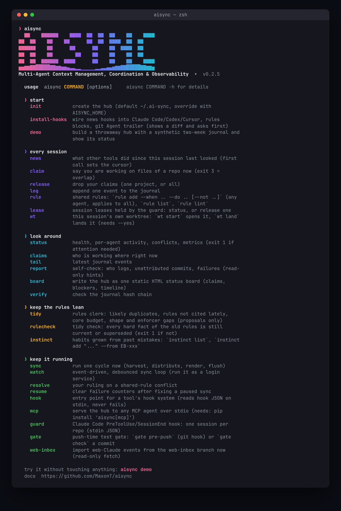

<!-- translated from README.md; the English README is the source of truth -->
[English](README.md) · [中文](README.zh-CN.md) · [日本語](README.ja.md) · **한국어** · [Español](README.es.md) · [Français](README.fr.md) · [Deutsch](README.de.md) · [Português](README.pt.md) · [Русский](README.ru.md)


<div align="center">


# aisync: 다중 에이전트 컨텍스트 관리, 조정 및 관측성

**여러 AI 코딩 에이전트를 함께 쓰는 개발자를 위한 로컬 허브입니다. 올바른 컨텍스트를 공유하고, 동시 작업을 조정하며, 무슨 일이 있었는지 검증하세요.**

aisync는 핵심부터 **에이전트 중립적**입니다. Claude Code, Codex, Cursor용 네이티브 훅을 제공하며, CLI, MCP 서버 또는 공유 지침 파일을 통해 허브를 다른 에이전트에도 노출합니다. 이 세 가지 네이티브 연동은 aisync를 쓸 수 있는 에이전트를 제한하는 것이 **아닙니다**.

[](https://github.com/MaxonT/aisync/actions/workflows/ci.yml)
[](https://github.com/MaxonT/aisync/releases)


[](https://pypi.org/project/aisync-cli/)
[](https://www.npmjs.com/package/@mingyang2026/aisync-cli)
[](https://github.com/MaxonT/homebrew-tap)
[](https://github.com/MaxonT/aisync/pkgs/container/aisync)
[](https://github.com/MaxonT/aisync/stargazers)

**English** · [中文](README.zh-CN.md) · [웹사이트](https://maxont.github.io/aisync/) · [데모 상태 보드](https://maxont.github.io/aisync/board/)

</div>

> [!NOTE]
> **여러 코딩 에이전트가 분리된 규칙, 충돌하는 파일 소유권, 끊어진 이력을 안고 일할 필요는 없습니다.**
> aisync는 다중 에이전트 워크플로를 위해 설계된 **로컬의 검증 가능한 허브**입니다 (`~/.ai-sync/`, git 저장소):
>
> - **컨텍스트 관리:** 규칙을 공유하고 3-way 동기화합니다. 핵심 컨텍스트는 미리 불러오고, 관련 컨텍스트는 필요할 때 주입합니다. 훅을 사용할 수 있는 곳에서는 세션 중 업데이트도 포함합니다.
> - **다중 에이전트 조정:** 파일 클레임을 선언하고, 겹치는 클레임을 감지하며(종료 코드 3), 소유권을 해제하고, 블로커와 다른 에이전트의 활동을 드러냅니다.
> - **관측성 및 검증:** 저널, 상태 보고서, 보드로 에이전트 활동, 블로커, 상태를 확인합니다. `aisync verify`는 저널의 해시 체인을 검사해 변조를 찾습니다.
>
> 파일 클레임은 **협력적**이며, OS가 강제하는 잠금이 아닙니다. 에이전트가 클레임 프로토콜을 따라야 합니다. 해시 체인 검증은 기록된 이벤트의 변경을 감지하지만, 클레임한 모든 작업이 실제로 일어났다는 것을 증명하지는 않습니다.

## 대상 사용자

하나 이상의 저장소에서 **두 개 이상의 AI 코딩 에이전트**를 돌리는 개발자, 특히 에이전트가 동시에 일하거나 작업을 넘겨주거나 결정과 블로커의 공유 기록이 필요할 때입니다. aisync는 또 하나의 코딩 에이전트나 작업 오케스트레이터가 아니라, 이 에이전트들이 쓸 수 있는 **공유 컨텍스트 및 조정 계층**입니다.

## 미리 보기

<div align="center">

### 에이전트 스웜 플로어


https://github.com/user-attachments/assets/f741ef6f-0c10-46f4-8c94-769c6e02d30e


## 연동: 네이티브 훅이 호환성의 경계는 아닙니다

| 연동 | 사용 가능한 대상 | 기대할 수 있는 것 |
|---|---|---|
| **네이티브 훅** | Claude Code, Codex, Cursor | 지원되는 훅 이벤트에서 컨텍스트와 뉴스를 자동으로 전달하며, aisync의 조정 및 저널 명령에 접근할 수 있음 |
| **MCP 서버** | MCP 호환 에이전트 | 규칙, 규칙 추가, 로깅, 클레임, 해제, 뉴스, 상태, 정리를 노출하며, 에이전트가 도구를 직접 호출해야 함 |
| **CLI** | 셸 명령을 실행할 수 있는 에이전트 | `aisync claim`, `aisync news`, `aisync log`, `aisync verify` 같은 허브 작업에 직접 접근 |
| **공유 지침 파일** | 지원되는 지침 파일을 읽는 에이전트 | 상시 규칙과 컨텍스트만 제공. 세션 중 자동 뉴스나 파일 클레임 강제는 없음 |

**호환된다고 해서 자동 연동되는 것은 아닙니다.** 네이티브 훅이 없는 에이전트는 MCP/CLI 사용법과 설정에 따라 기능이 달라집니다. aisync는 모든 편집을 자동으로 가로채지 않으며, 모든 에이전트가 파일 클레임을 지킨다고 보장하지 않습니다.

<p align="center"></p>

## 설치

**AI에게 맡기세요.** AI가 페이지를 읽고, 먼저 드라이 런을 한 뒤, 무엇이든 바꾸기 전에 물어봅니다:

```text
Read https://maxont.github.io/aisync/install and install aisync for me.
```

**또는 터미널에서.** uv, pipx 또는 pip으로 설치하며, 셸 설정 파일은 절대 수정하지 않습니다:

```bash
curl -fsSL https://maxont.github.io/aisync/install.sh | bash
```

macOS 또는 Linux에서 Python 3.11 이상과 git이 필요합니다. 그 밖에는 필요 없습니다. aisync는 표준 라이브러리만 사용합니다.

**📦 패키지 관리자로 설치할 수도 있습니다.** 명령어는 여전히 `aisync`입니다:

```bash
pipx install aisync-cli           # 🐍 PyPI (or: uv tool install aisync-cli)
npx @mingyang2026/aisync-cli --version   # npm 0.2.9
brew install maxont/tap/aisync    # 🍺 Homebrew tap (Python 3.14 first)
docker run --rm ghcr.io/maxont/aisync --version   # 🐳 GHCR image
```


### 에이전트 두 개, 파일 하나


<sub>실제 터미널 실행 기록입니다. `aisync demo`(합성 데이터)를 실행한 뒤, 두 도구가 같은 파일에 손을 댑니다.
단계별 설명: [작동 방식](https://maxont.github.io/aisync/how-it-works/) · 같은 데모 허브를 [상태 보드](https://maxont.github.io/aisync/board/)로 보기.</sub>

</div>

| 다중 에이전트 요구 | aisync가 제공하는 것 |
|---|---|
| **컨텍스트 관리** | 3-way 동기화되는 규칙, 계층형 규칙 로딩, 훅을 통한 관련 세션 중 뉴스 |
| **다중 에이전트 조정** | 협력적 파일 클레임과 해제, 겹침 감지(종료 코드 3), 블로커 및 활동 업데이트 |
| **관측성 및 검증** | 해시 체인 이벤트 저널, `aisync verify`, `status`, `report`, `tail`, 정적 `board` |

aisync는 규칙 관리도 담당합니다. 규칙 블록 하나를 각 도구의 규칙 파일에 복사하고, 3-way로 동기화하며, 충돌은 절대 덮어쓰지 않습니다.

**자체 사용 중:** 작성자 본인의 허브에서 저널 이벤트 6,700개 이상이 기록되었습니다.

## AGENTS.md만으로는 안 되나요?

저장소의 상시 지침은 AGENTS.md에 그대로 두세요. aisync는 그 옆에 놓여, 파일 하나로는 다룰 수 없는 것, 즉 에이전트가 작업하는 동안 바뀌는 컨텍스트를 다룹니다.

| | AGENTS.md | aisync |
|---|---|---|
| 범위 | 저장소에서 작업하는 에이전트를 위한 상시 지침 | 설정된 에이전트와 저장소 전반에 걸친 공유 허브 |
| 언제 읽히나 | 세션이 시작될 때 | 시작할 때, 그리고 훅을 통해 세션 중에도 |
| 누가 무엇을 편집하나 | 다루지 않음 | 협력적 클레임: 겹치면 호출자에게 종료 코드 3을 반환 |
| 변조 증거 | 파일 형식이 제공하지 않음 | 해시 체인 저널: `aisync verify`가 기록된 이벤트의 변경을 감지 |
| 세션당 컨텍스트 | 매번 파일 전체 | 트리거된 규칙만: 상시 로드 규칙 20,673 → 7,876 토큰* |

<sub>\* 작성자 본인의 허브에서 한 번 측정한 값입니다(2026-11-08). 계층형 로딩 전과 후의 상시 로드 규칙 크기입니다. 한 대의 기계에서 잰 값이며 벤치마크가 아닙니다. 여러분의 수치는 다를 수 있습니다. `aisync tidy`는 여러분 자신의 규칙 예산과 인용되지 않는 규칙을 보고합니다.</sub>

## 사용법

```bash
aisync demo            # a throwaway hub with a synthetic two-week journal
aisync init            # create ~/.ai-sync (or wherever AISYNC_HOME points)
aisync install-hooks   # shows every tool config change as a diff, then asks
aisync watch &         # event-driven sync loop (or run `aisync sync` by hand)
```

세션 중 에이전트가 하는 일:

```bash
aisync claim   -a codex -p api -f app/payments/ -m "SDK upgrade"  # 3 = taken
aisync log     -a codex -p api -m "SDK 5.0, retries kept"
aisync rule add -a codex --when "changing an API" --do "add a contract test"
aisync release -a codex -p api
```

| 명령 | 하는 일 |
|---|---|
| `init` | 허브 생성: 공유 규칙, 저널, 설정, 로컬 git 저장소 |
| `log` | 이벤트 하나 추가 (`dev_log`, `decision`, `blocked`, `unblocked`, `rule_change`, `note`) |
| `rule add` / `rule list` | 어떤 에이전트든 공유 규칙을 추가 (`--when/--do/--not`, `--topic`, `--replaces R-012`). 모든 도구의 사본이 다음 동기화 때 반영됨 |
| `rule lint` / `rule rewrite` / `rule enforcement` | When/Do/Not 형태가 아닌 규칙 찾기 / ID로 규칙을 다시 쓰되 사실은 잃지 않기 / 각 규칙을 지키는 테스트나 훅 확인 |
| `rule enforce` | 기존 규칙을 지키는 장치를 지정: `rule enforce R-012 --enforced-by tests/test_x.py`, `--judgment-only "<why>"`, 또는 가능하지만 아직 작성하지 않은 점검에 대해 `--planned "<the check to write>" --size S\|M\|L`. 그러면 `rule enforcement`가 열려 있는 항목마다 다음 단계를 보여줍니다: 사라진 강제 파일, 기한(S 7일, M 30일, L 90일)을 넘긴 계획, 계획이 없는 규칙. 계획의 기한은 계속 흐르기만 합니다. 나중 날짜, 더 큰 크기, 판단 전용으로의 전환에는 `--reason`이 필요하며 기록에 남습니다 |
| `tidy` | 규칙 서기: 중복으로 보이는 규칙, 최근 인용되지 않은 규칙, 예산을 넘긴 핵심 계층. 제안만 하며, 체크는 사용자가 합니다 |
| `rulecheck` | 규칙 정리가 핵심 사실(경로, 숫자, 명령, ID)을 잃지 않았음을 증명 |
| `instinct` | 과거 실수에서 쌓인 선택적 습관 목록. 모든 세션에 주입됨 |
| `gate` | push 시점 테스트 게이트: `gate check`는 커밋에 대해 `./check.sh --fast`를 실행하고, git pre-push 훅은 `gate pre-push`를 호출 (옵트인, 아래 참고) |
| `web-inbox` | 지금 `web-inbox` 브랜치에서 웹 Claude 이벤트를 가져옴 (`--no-fetch`는 마지막으로 가져온 사본 사용) |
| `guard` | Claude Code 훅: 저장소당 세션 하나. 다른 세션이 저장소를 점유하면 편집을 거부 (옵트인, 아래 참고) |
| `lease` | 어떤 저장소를 누가 점유하는지(`lease status`), 또는 직접 해제(`lease release --key`) |
| `wt` | 세션 전용 git 워크트리: `wt start`로 열고, `wt land`는 main에 반영하며 `--yes`가 필요 (없으면 드라이 런) |
| `mcp` | stdio로 어떤 MCP 에이전트에게든 허브를 제공 (`pip install 'aisync-cli[mcp]'`) |
| `claim` / `release` / `claims` | 지금 누가 어떤 파일에서 작업 중인지. 겹치면 종료 코드 3 |
| `news` | 이 세션이 마지막으로 확인한 뒤 다른 도구가 한 일 |
| `hook <tool>` | Claude Code, Codex, Cursor 훅의 진입점 (훅 JSON을 읽으며 절대 실패하지 않음) |
| `install-hooks` | 훅을 연결하고, 규칙 블록을 심고, git `Agent:` 트레일러 훅을 추가. 쓰기 전에 diff를 보여주고 묻습니다 (`--dry-run`, `--yes`) |
| `status` | 상태, 충돌, 클레임, 블로커, 지표 (무언가 사용자의 확인이 필요하면 종료 코드 1) |
| `board` | 허브를 정적 HTML 페이지 하나로 작성: 클레임, 블로커, 누가 무엇을 했는지, 타임라인 |
| `report` | 읽기 전용 자가 점검: 조용한 도구, `Agent:` 트레일러가 없는 커밋, 오래된 블로커 |
| `tail` | 최신 저널 이벤트 |
| `verify` | 해시 체인 검사 |
| `sync` / `watch` | 동기화 한 사이클 실행 / 디바운스된 이벤트 기반 루프 |
| `resolve` / `resume` | 규칙 충돌 판정 / 일시 정지 후 실패 카운터 초기화 |
| `demo` | 위에서 보여준 일회용 허브 |
| `version` / `-v` / `-V` / `--version` | 버전 출력 |
| `help [command]` | 이 화면, 또는 명령 하나의 옵션 (`aisync help log`) |
| `update` | GitHub에서 새 릴리스를 확인하고 업그레이드 명령을 출력 (uv, pipx, install.sh, brew 또는 pip). 스스로 설치하지는 않음 |
| `doctor` | python, git, 허브 폴더, 저널 체인 확인 (실패 시 종료 코드 1) |
| `completion` | bash, zsh 또는 fish용 셸 자동완성 스크립트 출력: `eval "$(aisync completion zsh)"` |

## 0.2.0의 새 기능: 인터페이스로서의 규칙, 계층별 로딩

규칙 파일은 모든 세션이 비용을 치르고 아무도 읽지 않을 때까지 커집니다. 0.2.0은 규칙을 API처럼 다룹니다:

- **When / Do / Not.** 각 규칙은 안정적인 ID를 가진 한 줄입니다: `[R-087] When: <trigger>. Do: <action>. Not: <forbidden>.`
  이유는 규칙이 아니라 저널에 기록됩니다. `rule_spec = true`는 이 형식이 아닌 것을 거부하고, `rule lint`는 맞지 않는 규칙을 보여주며, `rule rewrite`는 ID로 오래된 규칙의 형태를 바꾸되 경로, 숫자, 명령을 빠뜨리는 재작성은 거부합니다.
- **계층.** 도구 사본에 `layer = "core"`를 표시하면, `core_topics`는 전체를 담고 나머지 주제는 한 줄씩만 담습니다.
  프롬프트나 도구 호출이 주제의 키워드(`[shelf]`)를 건드리면, 훅이 그 주제를 세션당 한 번 주입합니다.
  작성자 본인의 허브에서 이 방식으로 상시 로드 규칙이 20,673에서 7,876 토큰으로 줄었습니다.
- **안정적인 접두부.** `progress_file`은 실시간 진행 표를 공유 페이지 밖으로 옮겨, 페이지가 바이트 단위로 동일하게 유지되고 프롬프트 캐시가 계속 적중하도록 합니다.
- **서기이지 청소부가 아닙니다.** `aisync tidy`는 제안만 하며(중복, 인용되지 않은 규칙, 예산 초과) 절대 편집하지 않습니다. 대체된 규칙은 ID와 함께 `rules-archive.md`로 옮겨지며, 아무것도 삭제되지 않습니다.
- **모든 에이전트.** 세 가지 입구가 있습니다: AGENTS.md 페이지, CLI, 그리고 `aisync mcp`(도구: rules, rule_add, log, claim, release, news, status, tidy). 핵심은 표준 라이브러리만 사용하며, MCP SDK는 선택 사항인 `aisync-cli[mcp]` 추가 기능입니다.

## 작동 방식

<p align="center"></p>
<p align="center"><sub><a href="https://maxont.github.io/aisync/how-it-works/">단계별로 천천히 보기</a> (재생, 일시정지, ← →)</sub></p>

동기화 한 사이클은 `harvest`(감시 중인 저장소의 새 git 커밋이 저널 이벤트가 되며, `Agent:` 트레일러로 귀속됨) → `rules`(`rule_sources`에 나열된 저장소의 새 항목) → `distribute`(규칙 블록을 각 도구 파일에 3-way 동기화) → `render`(진행 페이지) → `flush`(허브 커밋, 선택적으로 push)로 이루어집니다. 각 단계는 격리되어 있어서, 한 단계의 실패가 다른 단계를 막지 않습니다.

규칙 블록은 3-way로 동기화됩니다. 원본만 바뀌었다면 사본을 덮어씁니다(백업 포함). 사본 하나만 편집되었고 다른 쪽은 아무것도 바뀌지 않았다면, 그 편집을 모든 곳에 반영합니다. 양쪽이 모두 바뀌었다면 아무것도 덮어쓰지 않고, 여러분이 해결해야 할 충돌로 남깁니다.

신뢰성과 관측성: 모든 git 호출에 타임아웃과 백오프 재시도, 단계별·프로젝트별 실패 격리, 연속 `fail_threshold` 실패 후 `ALERT.md`와 데스크톱 알림을 동반한 자동 일시 정지, 사이클마다 실행 로그(`state/runs.jsonl`), 훅 호출 통계, 그리고 이 모든 것을 보여주는 `aisync status`.

## 설정

`~/.ai-sync/config.toml` (허브를 다른 곳에 두려면 `AISYNC_HOME`을 설정하세요):

```toml
roster = ["claude-code", "codex", "cursor"]   # tools `report` expects to hear from
scan_dirs = ["~/projects"]                    # every git repo inside is watched
rule_sources = []                             # repos whose AGENTS.md "## Meta rule" feeds shared rules
remote = ""                                   # e.g. "origin" to also push the hub

progress_file = "progress.md"                 # keep agents.md byte-stable; hooks inject progress at session start
rule_spec = true                              # rule add only accepts When/Do/Not rules
require_enforcer = false                      # true: every new rule names --enforced-by or --judgment-only
core_topics = ["Safety", "Meta"]              # topic headings a layered copy carries in full
instincts_path = ""                           # optional habit file injected at session start
tidy_daily = false                            # the watcher starts one `aisync tidy --write` a day
tidy_usage_globs = []                         # files whose R-### mentions count as a rule being used
gate_hook = false                            # opt-in: the git pre-push hook runs the test gate (gate.py)
guard_hook = false                           # opt-in: Claude Code runs the one-session-per-repo guard (guard.py)
web_inbox_secs = 0                           # 0 = off; else poll the web-inbox branch this often

[shelf]                                       # folded topic -> keywords that pull it into a session
Deploys = ["deploy", "terraform", "rollback"]

[[target]]                                    # files carrying the shared-rules block
label = "claude-code"
path = "~/.claude/CLAUDE.md"
layer = "core"                                # optional: fold non-core topics, inject them on demand
```

`aisync watch`를 계속 실행하려면, `aisync watch`를 실행하는 로그인 항목, systemd 사용자 유닛 또는 launchd 에이전트로 시작하세요. 깔끔하게 멈추려면 `~/.ai-sync/STOP` 파일을 만드세요.

**옵트인 기능(모두 기본적으로 꺼져 있음).** `gate_hook`, `guard_hook`, `web_inbox_secs`는 허브 바깥의 동작을 바꾸므로, 설정하기 전까지는 아무것도 켜지지 않습니다. guard는 편집을 거부할 수 있습니다. 세션이 잠겼다면 `aisync lease status`를 실행하고, 점유 중인 세션이 끝난 뒤 `aisync lease release --key <repo>`를 실행하세요. guard를 되돌리려면 `~/.claude/settings.json`에서 명령이 ` guard`로 끝나는 `PreToolUse` 및 `SessionEnd` 항목을 삭제하세요.

## 선배 프로젝트들 덕분에

> aisync: 다중 에이전트 컨텍스트 관리, 조정 및 관측성. AGENTS.md가 출발점이었습니다.

| 프로젝트 | aisync를 어떻게 만들었나 |
|---|---|
| [](https://github.com/agentsmd/agents.md) | 출발점이 된 아이디어: 모든 에이전트가 읽는 평문 지침 파일 하나이며, SDK가 필요 없습니다. aisync는 공유 규칙에 대해 이 형태를 유지합니다(규칙 블록 하나를 각 도구의 AGENTS.md / CLAUDE.md에 복사). 그리고 정적 파일이 말할 수 없는 것을 더합니다. 지금 누가 무엇을 편집하고 있는지, 세션이 시작된 뒤 무엇이 바뀌었는지. |
| [](https://github.com/anthropics/claude-code) | 세션 중 뉴스는 Claude Code 훅으로 전달됩니다. `aisync install-hooks`는 ~/.claude/settings.json에 SessionStart, UserPromptSubmit, PostToolUse 항목을 추가하며, `aisync hook claude-code`는 다른 도구가 무언가 바꿨을 때에만 hookSpecificOutput.additionalContext로 응답합니다. |
| [](https://github.com/openai/codex) | Codex는 ~/.codex/AGENTS.md를 읽으며, aisync는 여기에 공유 규칙 블록을 심습니다. Codex의 hooks.json도 같은 SessionStart / UserPromptSubmit / PostToolUse 이벤트를 받으므로, `aisync hook codex`는 Claude Code 응답 형식을 그대로 재사용합니다. |
| [Cursor](https://cursor.com/docs/agent/hooks) | Cursor 훅(~/.cursor/hooks.json)은 sessionStart에서 규칙과 진행 상황을, 각 postToolUse 후에 뉴스를 additional_context로 전달합니다. Cursor의 사용자 규칙은 aisync가 동기화할 수 있는 파일이 아니라 앱 안에 있기 때문입니다. |
| [](https://github.com/git/git) | 저널은 git의 해시 체인을 빌려 씁니다. 모든 이벤트는 바로 앞 이벤트의 id를 저장하고, 자신의 id는 그 연결과 본문의 SHA-256입니다. 그래서 `aisync verify`는 편집되거나, 유실되거나, 순서가 바뀐 줄을 찾아냅니다. 허브 자체는 로컬 git 저장소입니다. |

aisync는 독립 프로젝트이며, 위의 프로젝트들과 제휴 관계가 없습니다.

## 개발

```bash
python3 -m unittest discover -s tests   # includes wheel -> venv -> demo
```

이미지는 생성된 것입니다. 터미널 GIF는 [`.github/refine/demo-terminal.json`](.github/refine/demo-terminal.json)을 실제로 녹화한 실행이고, 작동 방식 애니메이션은 [`.github/refine/how-it-works.stages.json`](.github/refine/how-it-works.stages.json)에서, 위의 크레딧은 [`.github/refine/lineage.json`](.github/refine/lineage.json)에서 만들어졌습니다. 모든 데모 데이터는 합성 데이터입니다.

MIT 라이선스.


## 더 보고 싶다면 영상도 있어요!

https://github.com/user-attachments/assets/5ea7928b-4985-4700-8551-90477a84df40

https://github.com/user-attachments/assets/91385ac4-714c-4a16-908b-1859ef1c78e2


https://github.com/user-attachments/assets/bf661d5c-b7b1-4876-8469-2e11dd95b232


https://github.com/user-attachments/assets/d32f3abd-2986-4fbf-83a2-be287f0185a7

