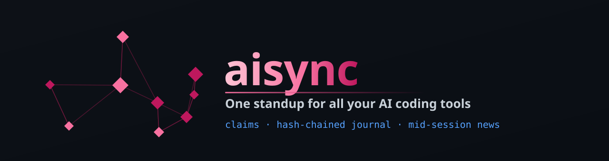
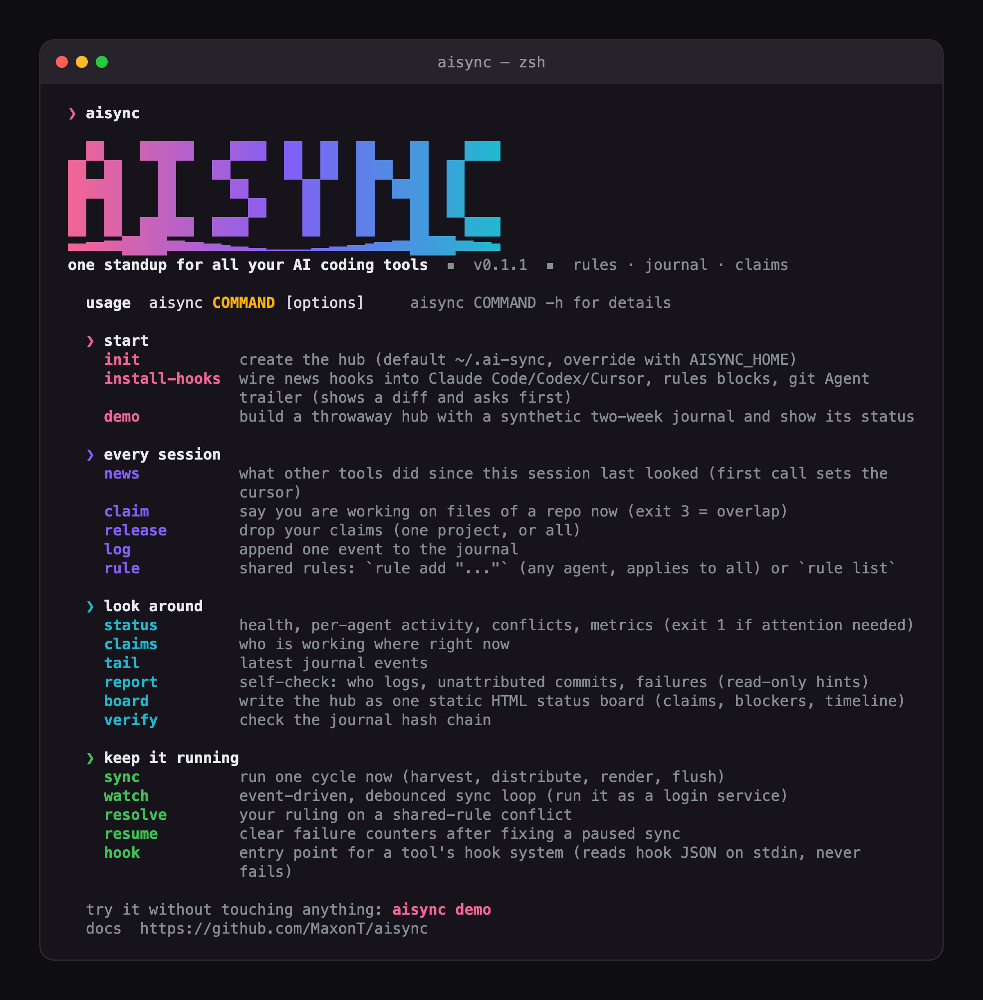
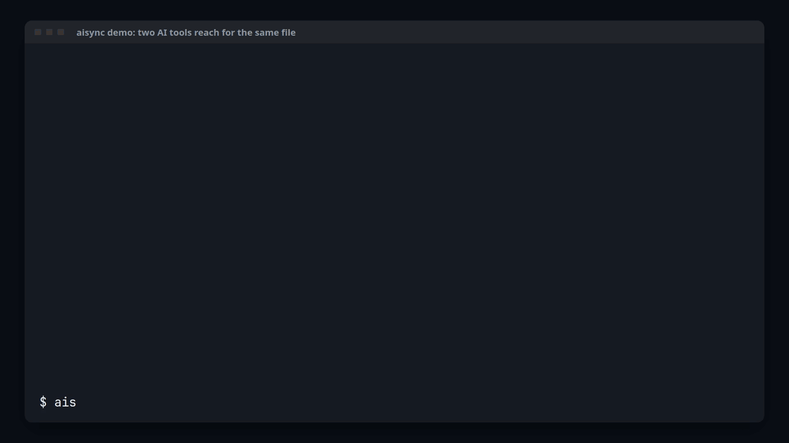
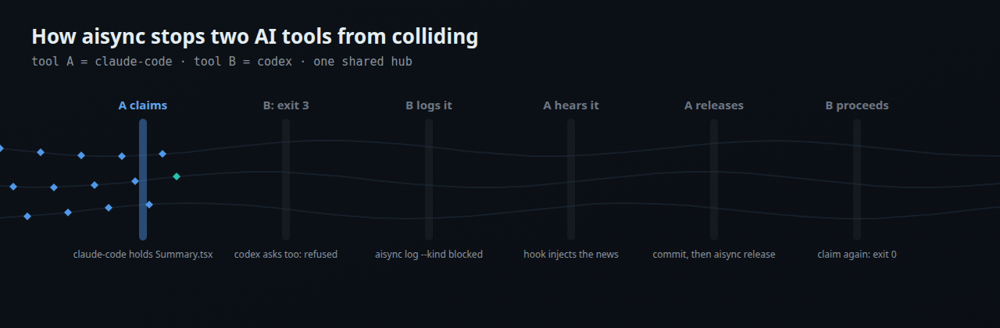

<div align="center">



# aisync: one standup for all your AI coding agents

**Claude Code, Codex and Cursor share rules, a journal and file claims, and hear what the others did mid-session.**

[](https://github.com/MaxonT/aisync/actions/workflows/ci.yml)
[](https://github.com/MaxonT/aisync/releases)


[](https://github.com/MaxonT/aisync/stargazers)

**English** · [中文](README.zh-CN.md) · [Website](https://maxont.github.io/aisync/) · [Demo status board](https://maxont.github.io/aisync/board/)

</div>

> [!NOTE]
> **Your AI tools are coworkers who never talk. aisync is their standup.**
> Every tool works out of one local hub (`~/.ai-sync/`, a git repo). Before editing, an agent
> **claims** files, and an overlapping claim exits with code 3, so the agent stops before it collides.
> Every decision, blocker and commit goes into one **hash-chained journal**. **Hooks** tell a
> running Claude Code, Codex or Cursor session what the other tools just did, and stay silent when
> nothing changed.

If aisync keeps your agents from stepping on each other, a star helps other people find it.

<p align="center"></p>

## Install

**Give it to your AI.** It reads the page, does a dry run first and asks before it changes anything:

```text
Read https://maxont.github.io/aisync/install and install aisync for me.
```

**Or in a terminal.** It installs with uv, pipx or pip and never edits your shell config:

```bash
curl -fsSL https://maxont.github.io/aisync/install.sh | bash
```

Needs Python 3.11+ and git, on macOS or Linux. Nothing else: aisync uses only the standard library.

After your first successful command, the CLI asks once: `Star MaxonT/aisync on GitHub? [y/N]`. The default is no, it never asks again, and it stays silent in CI, pipes and scripts. A yes stars the repo through your own `gh` login (or prints the link if `gh` is missing). Set `NO_STAR_PROMPT=1` to skip the question.

## See it



<sub>A real terminal run: `aisync demo` (synthetic data), then two tools reach for the same file.
Step by step: [how it works](https://maxont.github.io/aisync/how-it-works/) · the same demo hub as a
[status board](https://maxont.github.io/aisync/board/).</sub>

| | Rules sync tools | aisync |
|---|---|---|
| **Claims** | None: two agents can edit the same file at once | `aisync claim` first; an overlap exits with code 3 and says who holds the files |
| **Journal** | No shared record of who did what | One append-only, hash-chained log of commits, decisions and blockers (`aisync verify`) |
| **Mid-session news** | Rules load when a session starts, then go quiet | Hooks inject what the other tools just did into the running session |

aisync also does the rules part: one rules block copied into every tool's own rule file, synced 3-way, conflicts never overwritten.

**Dogfooded:** 1,600+ journal events from 5 AI tools over 9 days.

## Use it

```bash
aisync demo            # a throwaway hub with a synthetic two-week journal
aisync init            # create ~/.ai-sync (or wherever AISYNC_HOME points)
aisync install-hooks   # shows every tool config change as a diff, then asks
aisync watch &         # event-driven sync loop (or run `aisync sync` by hand)
```

What an agent does during a session:

```bash
aisync claim   -a codex -p api -f app/payments/ -m "SDK upgrade"  # 3 = taken
aisync log     -a codex -p api -m "SDK 5.0, retries kept"
aisync rule add -a codex "every API change ships a contract test"
aisync release -a codex -p api
```

| Command | What it does |
|---|---|
| `init` | create the hub: shared rules, journal, config, local git repo |
| `log` | append one event (`dev_log`, `decision`, `blocked`, `unblocked`, `rule_change`, `note`) |
| `rule add` / `rule list` | any agent adds a shared rule; every tool's copy gets it on the next sync |
| `claim` / `release` / `claims` | who is working on which files right now; overlap = exit 3 |
| `news` | what other tools did since this session last looked |
| `hook <tool>` | entry point for Claude Code, Codex and Cursor hooks (reads hook JSON, never fails) |
| `install-hooks` | wire the hooks, seed the rules block, add the git `Agent:` trailer hook; diff first, asks before writing (`--dry-run`, `--yes`) |
| `status` | health, conflicts, claims, blockers, metrics (exit 1 when something needs you) |
| `board` | write the hub as one static HTML page: claims, blockers, who did what, timeline |
| `report` | read-only self-check: silent tools, commits without an `Agent:` trailer, stale blockers |
| `tail` | latest journal events |
| `verify` | check the hash chain |
| `sync` / `watch` | run one sync cycle / the debounced, event-driven loop |
| `resolve` / `resume` | rule on a rule conflict / clear failure counters after a pause |
| `demo` | the throwaway hub shown above |

## How it works

<p align="center"></p>
<p align="center"><sub><a href="https://maxont.github.io/aisync/how-it-works/">Step through it at your own pace</a> (play, pause, ← →)</sub></p>

A sync cycle is `harvest` (new git commits in watched repos become journal events, attributed by
their `Agent:` trailer) → `rules` (new entries in repos you list in `rule_sources`) → `distribute`
(3-way sync of the rules block into each tool file) → `render` (progress page) → `flush` (commit the
hub, optional push). Each step is isolated: one failure never blocks the others.

The rules block is synced 3-way. If only the truth changed, copies are overwritten (with a backup).
If one copy was edited and nobody else changed anything, the edit is adopted everywhere. If both
sides changed, nothing is overwritten: it becomes a conflict for you to resolve.

Reliability and observability: timeouts and retries with backoff on every git call, failure
isolation per step and per project, auto-pause after `fail_threshold` failures in a row with an
`ALERT.md` and a desktop notification, a per-cycle run log (`state/runs.jsonl`), hook call stats and
`aisync status` for all of it.

## Configuration

`~/.ai-sync/config.toml` (set `AISYNC_HOME` to put the hub anywhere):

```toml
roster = ["claude-code", "codex", "cursor"]   # tools `report` expects to hear from
scan_dirs = ["~/projects"]                    # every git repo inside is watched
rule_sources = []                             # repos whose AGENTS.md "## Meta rule" feeds shared rules
remote = ""                                   # e.g. "origin" to also push the hub

[[target]]                                    # files carrying the shared-rules block
label = "claude-code"
path = "~/.claude/CLAUDE.md"
```

To keep `aisync watch` running, start it from your login items, a systemd user unit or a launchd
agent that runs `aisync watch`; create `~/.ai-sync/STOP` to stop it cleanly.

## Standing on the shoulders of

> aisync: AGENTS.md, but for live coordination between AI tools.

| Project | How it shaped aisync |
|---|---|
| [](https://github.com/agentsmd/agents.md) | The starting idea: one plain-text instruction file every agent reads, no SDK. aisync keeps that shape for shared rules (one rules block copied into each tool's own AGENTS.md / CLAUDE.md) and adds what a static file cannot say: who is editing what right now, and what changed since the session started. |
| [](https://github.com/anthropics/claude-code) | Mid-session news rides on Claude Code hooks: `aisync install-hooks` adds SessionStart, UserPromptSubmit and PostToolUse entries to ~/.claude/settings.json, and `aisync hook claude-code` answers with hookSpecificOutput.additionalContext only when another tool changed something. |
| [](https://github.com/openai/codex) | Codex reads ~/.codex/AGENTS.md, which is where aisync seeds the shared rules block, and its hooks.json takes the same SessionStart / UserPromptSubmit / PostToolUse events, so `aisync hook codex` reuses the Claude Code reply format. |
| [Cursor](https://cursor.com/docs/agent/hooks) | Cursor hooks (~/.cursor/hooks.json) deliver the rules and progress at sessionStart and the news after each postToolUse through additional_context, because Cursor's User Rules live inside the app instead of a file aisync could sync. |
| [](https://github.com/git/git) | The journal borrows git's hash chain: every event stores the id of the one before it and its own id is a SHA-256 of that link plus its body, so `aisync verify` spots any edited, lost or reordered line. The hub itself is a local git repo. |

aisync is an independent project, not affiliated with the projects above.

## Development

```bash
python3 -m unittest discover -s tests   # includes wheel -> venv -> demo
```

The images are generated: the terminal GIF is a recorded real run of
[`.github/refine/demo-terminal.json`](.github/refine/demo-terminal.json), the how-it-works animation
comes from [`.github/refine/how-it-works.stages.json`](.github/refine/how-it-works.stages.json), and the
credits above from [`.github/refine/lineage.json`](.github/refine/lineage.json). All demo data is synthetic.

MIT licensed.
