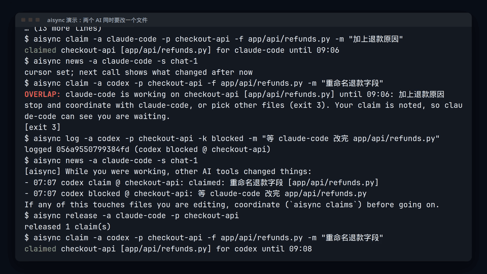
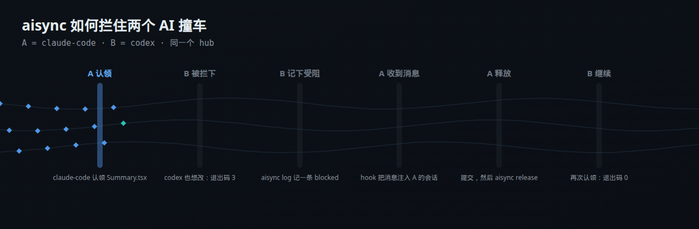

<div align="center">


# aisync：给你所有的 AI 编程 agent 开一场站会

**Claude Code、Codex、Cursor 共用一套规则、一本日志和一张“谁在改哪个文件”的认领表，干活途中就能知道别的工具刚做了什么。**

[](https://github.com/MaxonT/aisync/actions/workflows/ci.yml)
[](https://github.com/MaxonT/aisync/releases)


[English](README.md) · **中文** · [网站](https://maxont.github.io/aisync/) · [演示看板](https://maxont.github.io/aisync/board/)

</div>

> [!NOTE]
> **你的 AI 工具是一群从不交流的同事，aisync 就是它们的站会。**
> 所有工具都围着一个本地 hub（`~/.ai-sync/`，一个 git 仓库）干活。改文件之前先**认领**，
> 认领撞车时命令返回退出码 3，agent 在动手前就停下来。每个决定、受阻和提交都记进一本
> **哈希链日志**。**hook** 会把别的工具刚做的事注入正在运行的 Claude Code、Codex 或 Cursor
> 会话；没有新消息时一个字都不说。

如果 aisync 让你的几个 agent 不再互相踩脚，点个 star 能让更多人找到它。

## 安装

**交给你的 AI。** 它会读安装页，先 dry run，改任何东西之前都会先问你：

```text
Read https://maxont.github.io/aisync/install and install aisync for me.
```

**或者在终端里。** 用 uv、pipx 或 pip 安装，绝不改你的 shell 配置：

```bash
curl -fsSL https://maxont.github.io/aisync/install.sh | bash
```

需要 Python 3.11+ 和 git，macOS 或 Linux。别的都不需要：aisync 只用 Python 标准库。

## 看一眼



<sub>真实终端录屏：先 `aisync demo`（合成数据），再看两个工具同时伸手去改一个文件。
逐步讲解：[工作原理](https://maxont.github.io/aisync/how-it-works/zh.html) · 同一个演示 hub 的
[状态看板](https://maxont.github.io/aisync/board/)（英文页面）。</sub>

| | 规则同步工具 | aisync |
|---|---|---|
| **认领** | 没有：两个 agent 可以同时改同一个文件 | 先 `aisync claim`；撞车返回退出码 3，并告诉你谁占着这些文件 |
| **日志** | 没有“谁做了什么”的共同记录 | 一本只追加、哈希链接的日志，记提交、决定和受阻（`aisync verify` 校验） |
| **会话中消息** | 规则只在会话开始时加载，之后就没声了 | hook 把别的工具刚做的事注入正在运行的会话 |

规则同步 aisync 也做：一份规则块复制进每个工具自己的规则文件，三方同步，有冲突绝不覆盖。

**自己先用过：** 5 个 AI 工具、9 天、1,600+ 条日志事件。

## 用法

```bash
aisync demo                                   # 一个临时 hub，带两周的合成日志
aisync init                                   # 创建 ~/.ai-sync（可用 AISYNC_HOME 改位置）
aisync install-hooks                          # 先显示要改的每个工具配置的 diff，再问你
aisync watch &                                # 事件驱动的同步循环（或手动跑 aisync sync）
```

agent 在一次会话里会这样用：

```bash
aisync claim  -a codex -p checkout-api -f app/payments/ -m "SDK upgrade"   # 退出码 3 = 有人占着
aisync log    -a codex -p checkout-api -k dev_log -m "SDK 5.0, retries kept" -f app/payments/provider.py
aisync rule add -a codex "every API change ships with a contract test" --reason "two schema breaks"
aisync release -a codex -p checkout-api
```

| 命令 | 作用 |
|---|---|
| `init` | 创建 hub：共享规则、日志、配置、本地 git 仓库 |
| `log` | 追加一条事件（`dev_log`、`decision`、`blocked`、`unblocked`、`rule_change`、`note`） |
| `rule add` / `rule list` | 任何 agent 都能加一条共享规则，下次同步时每个工具的副本都会拿到 |
| `claim` / `release` / `claims` | 此刻谁在改哪些文件；撞车 = 退出码 3 |
| `news` | 这个会话上次看过之后，别的工具做了什么 |
| `hook <tool>` | Claude Code、Codex、Cursor 的 hook 入口（读 hook JSON，永不报错退出） |
| `install-hooks` | 接好 hook、写入规则块、加 git `Agent:` 尾注 hook；先给 diff，写之前先问（`--dry-run`、`--yes`） |
| `status` | 健康、冲突、认领、受阻、指标（需要你处理时退出码为 1） |
| `board` | 把 hub 写成一个静态 HTML 页面：认领、受阻、谁做了什么、时间线 |
| `report` | 只读自检：沉默的工具、缺 `Agent:` 尾注的提交、过期的受阻 |
| `tail` | 最近的日志事件 |
| `verify` | 校验哈希链 |
| `sync` / `watch` | 跑一次同步 / 防抖的事件驱动循环 |
| `resolve` / `resume` | 裁决规则冲突 / 暂停后清零失败计数 |
| `demo` | 上面那个临时 hub |

## 工作原理

<p align="center"></p>
<p align="center"><sub><a href="https://maxont.github.io/aisync/how-it-works/zh.html">按自己的节奏一步步看</a>（播放、暂停、← →）</sub></p>

一次同步依次是 `harvest`（被监视仓库里的新 git 提交变成日志事件，按 `Agent:` 尾注归属）→ `rules`
（`rule_sources` 里列出的仓库的新规则）→ `distribute`（把规则块三方同步进每个工具文件）→ `render`
（进度页）→ `flush`（提交 hub，可选推送）。每一步相互隔离：一步失败不会挡住其他步骤。

规则块是三方同步的。只有源头改了，就覆盖各个副本（留备份）；只有某个副本被改、别处都没动，就把这个改动推广到所有地方；两边都改了，什么都不覆盖，记成冲突等你裁决。

可靠性和可观测性：每个 git 调用都有超时和退避重试；按步骤、按项目隔离失败；连续失败
`fail_threshold` 次后自动暂停，写 `ALERT.md` 并弹桌面通知；每次同步写一行运行日志
（`state/runs.jsonl`）；hook 调用统计；`aisync status` 汇总这一切。

## 配置

`~/.ai-sync/config.toml`（设 `AISYNC_HOME` 可以把 hub 放在任何地方）：

```toml
roster = ["claude-code", "codex", "cursor"]   # report 期望收到消息的工具
scan_dirs = ["~/projects"]                    # 里面的每个 git 仓库都会被监视
rule_sources = []                             # 这些仓库 AGENTS.md 里的 "## Meta rule" 会变成共享规则
remote = ""                                   # 例如 "origin"，同时推送 hub

[[target]]                                    # 带共享规则块的文件
label = "claude-code"
path = "~/.claude/CLAUDE.md"
```

想让 `aisync watch` 一直运行，可以放进登录项、systemd 用户单元或 launchd agent；创建
`~/.ai-sync/STOP` 可以让它干净地停下。

## 站在这些项目的肩膀上

> aisync：AGENTS.md 管 agent 该怎么做，aisync 管多个 AI 工具此刻怎么配合。

| 项目 | 对 aisync 的影响 |
|---|---|
| [](https://github.com/agentsmd/agents.md) | 出发点：一个每个 agent 都会读的纯文本说明文件，不需要 SDK。aisync 用同样的形式管共享规则（一份规则块复制进各工具自己的 AGENTS.md / CLAUDE.md），并补上静态文件说不了的东西：此刻谁在改什么，会话开始后又变了什么。 |
| [](https://github.com/anthropics/claude-code) | 会话中消息基于 Claude Code hooks：`aisync install-hooks` 在 ~/.claude/settings.json 里加 SessionStart、UserPromptSubmit、PostToolUse，`aisync hook claude-code` 只在别的工具改了东西时用 hookSpecificOutput.additionalContext 回话。 |
| [](https://github.com/openai/codex) | Codex 会读 ~/.codex/AGENTS.md，aisync 正是把共享规则块写在这里；它的 hooks.json 支持同样的 SessionStart / UserPromptSubmit / PostToolUse 事件，所以 `aisync hook codex` 复用 Claude Code 的回复格式。 |
| [Cursor](https://cursor.com/docs/agent/hooks) | Cursor hooks（~/.cursor/hooks.json）在 sessionStart 送上规则和进度，在每次 postToolUse 之后通过 additional_context 送上消息，因为 Cursor 的 User Rules 存在应用内部，不是 aisync 能同步的文件。 |
| [](https://github.com/git/git) | 日志借用了 git 的哈希链：每条事件记下上一条的 id，自己的 id 是这条链接加内容的 SHA-256，所以 `aisync verify` 能发现任何被改、丢失或重排的行。hub 本身也是一个本地 git 仓库。 |

aisync 是独立项目，与上述项目没有隶属关系。

## 开发

```bash
python3 -m unittest discover -s tests     # 包括 构建 wheel -> 全新 venv -> aisync demo + verify
```

这些图片都是生成的：终端 GIF 录的是 [`.github/refine/demo-terminal.zh.json`](.github/refine/demo-terminal.zh.json)
的真实运行，工作原理动画来自 [`.github/refine/how-it-works.stages.zh.json`](.github/refine/how-it-works.stages.zh.json)，
上面的致谢来自 [`.github/refine/lineage.json`](.github/refine/lineage.json)。所有演示数据都是合成的。

MIT 许可证。
